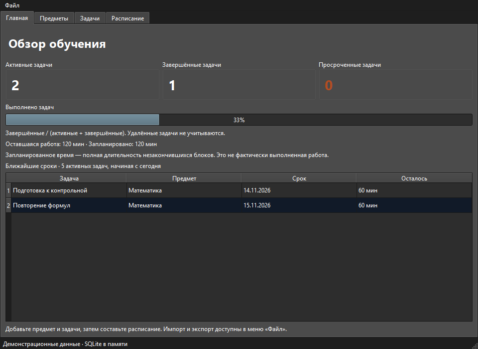
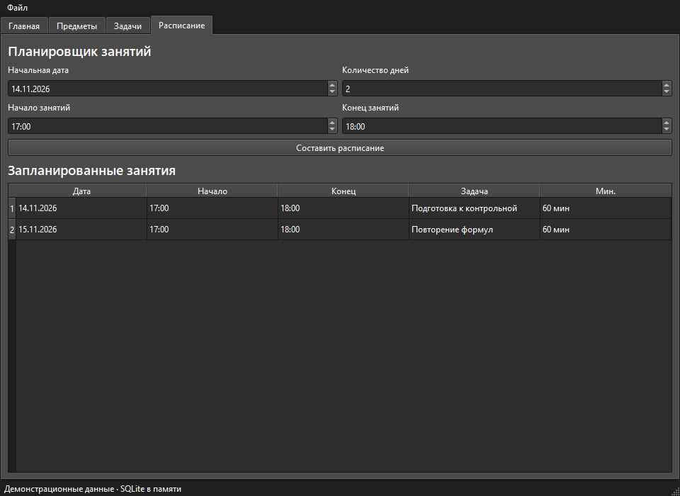

## Возможности

- Создание, переименование, поиск и удаление предметов.
- Создание и редактирование задач: предмет, приоритет, длительность, необязательный срок.
- Завершение и логическое удаление задач.
- Автоматическое расписание на 1–28 дней с блоками по 15–60 минут.
- Статистика: активные, завершённые и просроченные задачи, прогресс и ближайшие сроки.
- Сохранение данных и расписания в SQLite между запусками.
- Импорт/экспорт задач CSV, экспорт расписания CSV, отчёт TXT.
- Сборка в единый `.exe` для Windows.

## Как работает планировщик

Используется жадный алгоритм EDF (Earliest Deadline First):

1. Сначала задача с ближайшим сроком.
2. При равном сроке — с большим приоритетом.
3. При полном равенстве — с меньшим ID.
4. Задачи без срока рассматриваются последними.

Пересекающиеся свободные интервалы объединяются. Блоки не пересекаются и не
заканчиваются позже конца дня срока. Недостаток времени отображается как остаток
незапланированной работы. Глобальная оптимальность расписания не гарантируется.

**Составление плана не означает выполнение задачи.** Фактическое завершение
отмечается пользователем отдельно кнопкой «Выполнено».



## Технологии

Python · PyQt6 · Qt Designer · SQLite · CSV/TXT · PyInstaller

## Запуск из исходников

Проверено на Windows x64 и Python 3.13. Для исходников нужен Python 3.10 или новее.
После клонирования репозитория откройте терминал в его папке:

```powershell
python -m venv .venv
.\.venv\Scripts\python.exe -m pip install -r requirements.txt
.\.venv\Scripts\python.exe main.py
```

При первом запуске база и её таблицы создаются автоматически.

## Быстрый сценарий

1. На вкладке **Предметы** добавьте предмет.
2. На вкладке **Задачи** добавьте задачу. Приоритет: 1–5 (5 — самый высокий).
   Длительность: 15–1440 минут, кратная 15.
3. На вкладке **Расписание** выберите начальную дату, число дней и ежедневные часы.
4. Нажмите **Составить расписание**.
5. После выполнения выделите задачу и нажмите **Выполнено**.
6. Посмотрите обновлённую статистику на **Главной**.

Прогресс = завершённые / (активные + завершённые) × 100%. Удалённые задачи не
учитываются; если задач нет — 0%. Запланированные минуты не являются фактически
затраченным временем: учитывается полная длительность незакончившихся блоков.

Изменение срока, приоритета или длительности задачи удаляет её незакончившиеся
занятия: план нужно составить заново. Непустой новый план заменяет старый целиком.

## CSV и TXT

Меню **Файл** содержит все операции импорта и экспорта.

Для проверки используйте [example_tasks.csv](example_tasks.csv). В нём пять задач:
три активные, одна завершённая и одна удалённая, по трём предметам. Для планирования
обновите фиксированные даты в примере на актуальные.

Формат CSV: UTF-8 (BOM поддерживается), разделитель `;`.

```csv
title;subject;priority;duration_minutes;remaining_minutes;deadline;status
Изучить графы;Информатика;4;60;60;;active
Повторить формулы;Математика;3;30;0;;completed
```

Все семь столбцов обязательны. Срок — `ГГГГ-ММ-ДД` или пустое поле.
Статусы: `active`, `completed`, `deleted`. Остаток кратен 15 и не превышает
длительность; у завершённых задач он равен 0, у активных больше 0.

Импорт сначала проверяет весь файл, затем записывает его одной транзакцией.
Новые предметы создаются автоматически, точные дубликаты пропускаются.
Существующие задачи не обновляются: изменённая строка считается новой задачей.
CSV расписания предназначен только для экспорта. TXT содержит статистику,
задачи всех статусов и сохранённое расписание.

## Где хранятся данные

На Windows: `%LOCALAPPDATA%\StudyOS\studyos.db`. Точный путь виден в строке состояния.

Если при первом запуске пользовательской базы ещё нет, приложение может скопировать
старую `data/studyos.db`: при запуске исходников она ищется в папке проекта,
при запуске `.exe` — в папке `data` рядом с ним. Оригинал сохраняется.

Для отдельного профиля можно задать переменную `STUDYOS_DATA_DIR`:

```powershell
$env:STUDYOS_DATA_DIR = "$env:LOCALAPPDATA\StudyOS-Demo"
.\.venv\Scripts\python.exe main.py
```

Для резервной копии закройте приложение и скопируйте SQLite-файл.
Личные базы, окружение, пользовательские отчёты и сборки исключены из Git.

## Сборка `.exe`

Выполняется на Windows:

```powershell
.\.venv\Scripts\python.exe -m pip install -r requirements-build.txt
.\.venv\Scripts\python.exe -m PyInstaller --noconfirm --clean StudyOS.spec
```

Результат: `dist/StudyOS.exe`. Для его запуска отдельно устанавливать Python
не требуется. Формы `.ui` включены в сборку, база данных хранится отдельно.
Готовый файл рекомендуется распространять через GitHub Releases, а не хранить в Git.

## Структура проекта

| Файл | Назначение |
|---|---|
| `main.py` | Главное окно, действия пользователя, обновление таблиц |
| `task_dialog.py` | Форма задачи и проверка ввода |
| `database.py` | SQL-запросы, транзакции, статистика |
| `scheduler.py` | Независимый алгоритм планирования |
| `file_exchange.py` | Чтение/проверка CSV, экспорт CSV и TXT |
| `app_paths.py` | Каталог пользовательских данных и перенос базы |
| `ui/` | Формы Qt Designer |
| `StudyOS.spec` | Конфигурация PyInstaller |
| `docs/` | Презентация, скриншоты, сценарий защиты и публикации |
| `scripts/build_presentation.py` | Воспроизводимое создание презентации и демонстрационных скриншотов |

## Презентация и публикация

- [Скачать презентацию PPTX](docs/StudyOS_Presentation.pptx)
- [Посмотреть презентацию PDF](docs/StudyOS_Presentation.pdf)
- [Содержание слайдов и сценарий выступления](docs/presentation.md)
- [Как опубликовать через GitHub Desktop](docs/github_desktop.md)

Скриншоты и презентация используют демонстрационные данные. Пересоздание:

```powershell
.\.venv\Scripts\python.exe -m pip install -r requirements-docs.txt
.\.venv\Scripts\python.exe -B scripts\build_presentation.py
```

## Ограничения и развитие

Сейчас нет частичной отметки выполнения, автоматических перерывов и разных часов
по дням недели. Завершённые задачи доступны в отчётах и CSV, отдельной вкладки
истории нет. Эти возможности можно добавить при дальнейшем развитии проекта.
